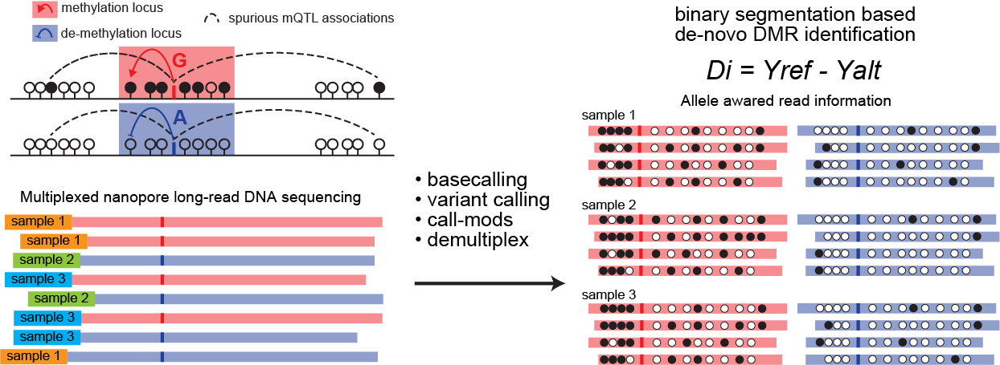

# nanoASM
One has a conviction that proxy ASM might be more causal than mQTL. This repository was developed to perform such validation

# Scripts
- scripts/dorado_basecall_cg.sh dorado basecalling, convert POD5 into ML:i and MM:i tagged BAM file
- scripts/bam_prep.sh — merge and slice BAM files
- scripts/variant_call_phase.sh — long-read variant calling and phasing
- scripts/vcf_prep.sh — filter and process VCF files

