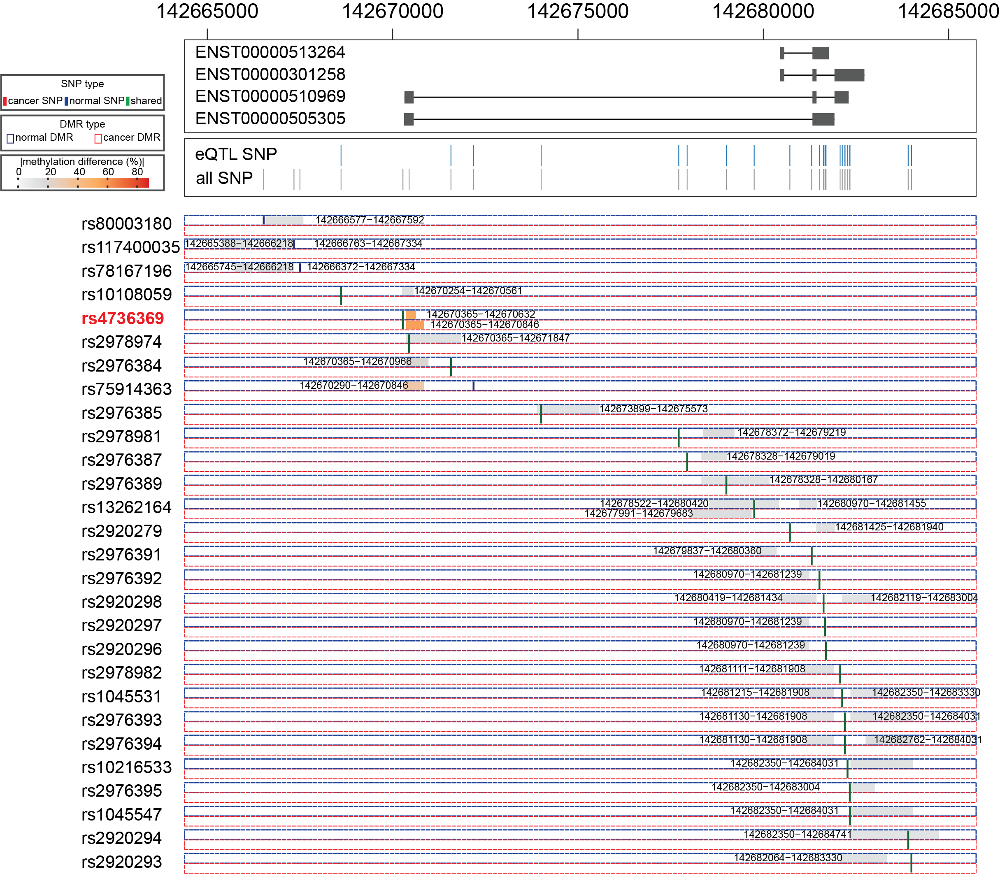

## nanoASM

One has a conviction that proxy ASM might be more causal than mQTL. This repository was developed to use nanopore long-read DNA sequencing data to perform such validation. Pipeline for allele-specific methylation (ASM) analysis using nanopore long-read sequencing.


Visualization of clustered ASM loci identified by nanoASM (GeneLevelASM.sh). Gene models, GTEx eQTL SNPs, and all common SNPs are shown in the upper panels. Each horizontal track represents a SNP associated with one or more allele-specific methylation regions (DMRs). Vertical bars indicate SNP positions, while colored rectangles denote DMR coordinates and methylation differences. Dashed blue and red outlines correspond to DMRs identified in normal and cancer tissues, respectively. This example highlights an ASM region associated with rs4736369 that is consistently observed in both normal and tumor tissues, suggesting a unique epigenetic regulatory mechanism linked to this variant.



---

## Overview

This repository contains scripts for:

* **Basecalling (Dorado)**
* **Variant calling and phasing**
* **Allele-specific methylation (ASM) detection**

The workflow is designed for nanopore R10 data with modified base detection (5mCG / 5hmCG).

---

## Installation

Clone the repository and ensure the required tools (such as Dorado, `samtools`, `bcftools`, `bedtools`, `modkit`, `metilene`, and Python with `pysam`) are installed and available in your `PATH`, with `METILENE_DIR` configured as shown below.

- **Typical install time on a standard desktop computer:** ~5–15 minutes (depending on whether dependencies such as `metilene` and conda/Python packages are pre-installed).

---

## Pipeline Structure

### 1. Basecalling

```bash
scripts/dorado_basecall_cg.sh
```

* Uses Dorado basecaller (R10.4.1 SUP model)
* Generates BAM files with CG-context modified bases
* Model: `5mCG / 5hmCG`

---

### 2. Call modified bases

Before running `bam_prep.sh`, call modified bases:

```bash
for bam in *.sorted.bam; do
  modkit call-mods -t 47 "$bam" "${bam%.sorted.bam}.called.bam"
done
```

* The resulting `*.called.bam` files are used as input for `bam_prep.sh`.

---

### 3. Variant Calling and Phasing

```bash
scripts/variant_call_phase.sh
```

* PEPPER-Margin-DeepVariant (optional / historical)
* SNP filtering via bcftools
* LongPhase phasing or population-based phasing
* Haplotagging BAM files

---

### 4. ASM Detection (Core)

```bash
scripts/asm_core.sh
```

Main steps:

* Label reads by allele using:

  ```bash
  utils/label_reads_by_variant.py
  ```
* Extract CpG methylation using `modkit`
* Build per-sample CpG `.bg` files
* Construct union CpG sites
* Filter sparse samples
* Run **metilene** for ASM detection
* Output:

  * DMR summary file
  * Optional matrix files for significant loci

---

### 5. Cohort Execution

Run ASM per cohort using Slurm:

```bash
scripts/run_asm_cancer.sh
scripts/run_asm_normal.sh
```

These scripts:

* iterate over chunked VCF inputs
* call `asm_core.sh`
* manage output directories and logs

---

## Key Dependencies

* Dorado
* samtools
* bcftools
* bedtools
* modkit
* metilene (v0.2-8 recommended)
* Python (pysam)
* R (for downstream analysis)

---

### metilene

`metilene` is required for ASM/DMR detection and is **not included** in this repository.

Download from:
https://www.bioinf.uni-leipzig.de/Software/metilene/

After installation, set the path:

```bash
export METILENE_DIR=/path/to/metilene_v0.2-8
```

The pipeline expects:

```bash
${METILENE_DIR}/metilene_linux64
```

---

## Demo

A minimal demo dataset is provided under `demo/`.

Run ASM on the demo data:

```bash
mkdir -p demo/output demo/output/matrices

bash scripts/asm_core.sh \
  demo/NormalChunk/chunk_demo.txt \
  demo/NormalSlice \
  demo/output/demo.output.txt \
  demo/output/matrices \
  demo/output/demo.log \
  0.9
```

Expected run time on a standard desktop computer: ~<1–2 minutes for the minimal demo/ dataset (full WGS cohorts require HPC/cluster resources and longer runtimes).

---

## Notes

* Scripts contain cluster-specific paths (`/share/lab_wangl/...`)
* These should be adapted for other environments
* Designed for high-depth nanopore WGS datasets

---

## Outputs

* `*.output.txt` → ASM/DMR results
* `*.matrix.txt` → per-locus methylation matrices for significant loci with sufficiently large delta only
* log files for segmentation faults and filtering steps

---

## Author

Yijun Tian

---

## Citation

https://doi.org/10.64898/2026.06.17.732357

---

